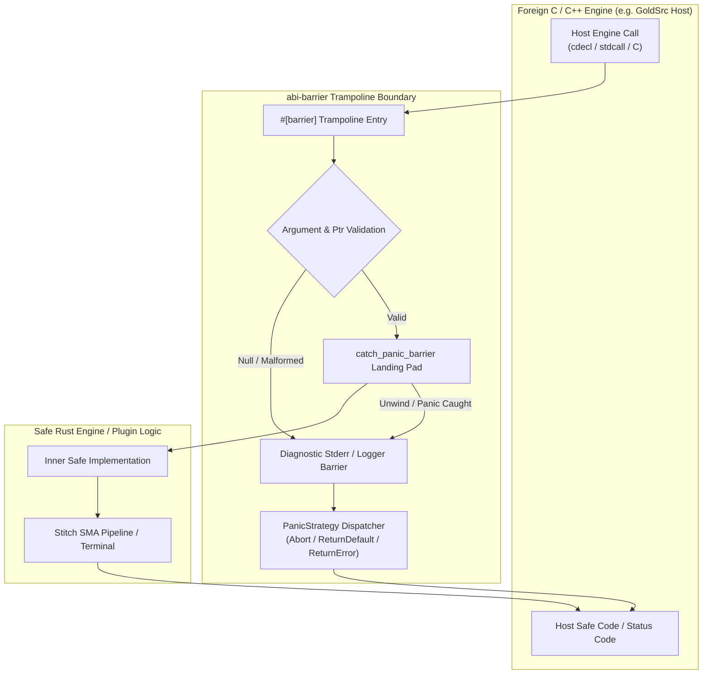
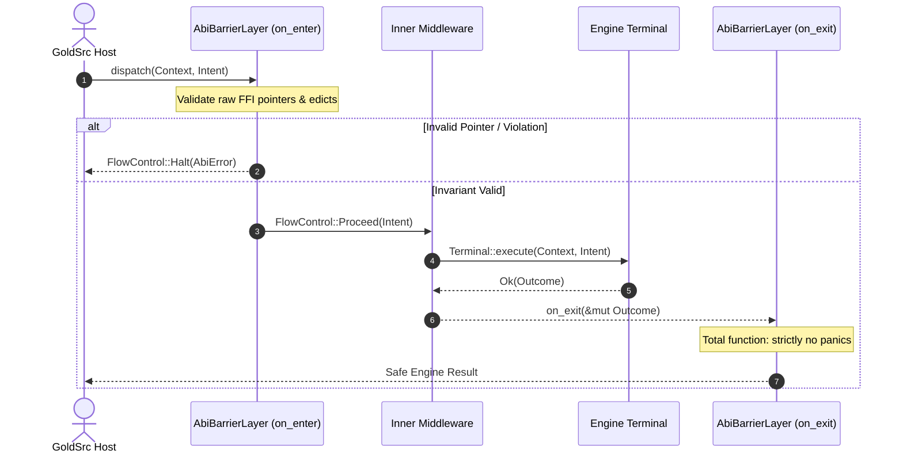

# Architecture Reference: `abi-barrier`

## 1. System Overview & Invariants

`abi-barrier` is a high-performance, unbreakable C-ABI safety boundary and FFI isolation meta-framework designed for native game engines (GoldSrc, Quake, Unreal) and host-plugin architectures.

In legacy C/C++ game engine environments, panicking or throwing unhandled exceptions across an `extern "C"` ABI boundary invokes immediate Undefined Behavior (UB), corrupts registers, or crashes the host process. `abi-barrier` mathematically guarantees that:

1. No Rust unwinding panic can ever cross the C-ABI perimeter.
2. No invalid `NULL` pointers or malformed UTF-8 strings are silently swallowed.
3. Every error and panic event is strictly diagnosed (Anti-Silent Error Suppression).
4. Happy path execution retains zero-cost parity (<0.50 ns overhead, zero heap allocations).

---

## 2. Closed-World Taxonomy Matrix

To eliminate stringly-typed configuration and enforce compile-time verification, `abi-barrier` models calling conventions and panic handling through closed-world enums.

### 2.1 Calling Conventions (`CallingConvention`)

| Variant | Target ABI Identifier | Typical Target Platforms | Use Case |
| :--- | :--- | :--- | :--- |
| `CallingConvention::C` | `extern "C"` | Cross-platform (Linux/Windows/macOS) | Default standard C interoperability. |
| `CallingConvention::Cdecl` | `extern "cdecl"` / `extern "C"` | x86 32-bit Linux / Windows (MSVC/GCC) | Standard GoldSrc engine export functions. |
| `CallingConvention::Stdcall` | `extern "stdcall"` | x86 32-bit Windows Win32 API | Windows system hooks and legacy DLL APIs. |
| `CallingConvention::Fastcall` | `extern "fastcall"` | x86 32-bit register-optimized calls | Low-latency register-based internal exports. |
| `CallingConvention::System` | `extern "system"` | Host OS native calling convention | Platform-abstracted system call interfaces. |

### 2.2 Panic Strategies (`PanicStrategy`)

| Variant | Reaction Semantics | Anti-Silent Behavior | Primary Domain |
| :--- | :--- | :--- | :--- |
| `PanicStrategy::Abort` | Unconditional `std::process::abort()` | Stderr diagnostic logged before hard termination. | Mission-critical server instances where partial memory corruption is fatal. |
| `PanicStrategy::ReturnDefault` | Returns `Default::default()` / `0` / `null` | Stderr diagnostic logged; error mapped via `AbiReturn`. | Standard query hooks where non-destructive recovery is permitted. |
| `PanicStrategy::ReturnError(i32)` | Returns explicit integer error code (`i32`) | Stderr diagnostic logged; code passed directly to host. | Engine commands, plugin initialization, and file I/O callbacks. |
| `PanicStrategy::Custom(fn)` | Delegates to user function `fn(&str) -> i32` | Stderr diagnostic logged; custom hook determines code. | Enterprise instrumentation, telemetry counters, and crash dumpers. |

---

## 3. Scrooge Systems Mindset: Zero-Allocation Happy Paths

`abi-barrier` enforces strict mechanical sympathy and zero-waste memory dynamics:

1. **Register Passing**: Function arguments (`i32`, pointers, sized structs) remain in CPU registers (`RCX`, `RDX`, `R8`, `R9` on x86_64; stack/registers on x86).
2. **Zero Heap Allocations**:
   - `ensure_non_null(*const T)` validates non-nullity with a single assembly test/jump (`test reg, reg; jz`).
   - `ensure_valid_c_str(*const c_char)` wraps the raw null-terminated pointer into `&CStr` and validates UTF-8 in-place without copying into an allocated `String`.
3. **Monomorphic Inlining**:
   - The proc-macro trampoline marks `#inner_fn_ident` as `#[inline(always)]`.
   - In release builds (`opt-level = 3`, LTO enabled), LLVM collapses the landing pad into zero runtime instructions on the non-panicking path.

---

## 4. Stitch SMA Middleware Integration (`AbiBarrierLayer`)

`AbiBarrierLayer` integrates directly into the Sewing Machine Architecture (SMA) U-cycle as defined in `stitch-rs`:

### U-Cycle Invariants

- **Phase 1 (Descent / `on_enter`)**: Validates C-context invariants (e.g., verifying client edict pointers are non-null). On invariant failure, it halts traversal immediately via `FlowControl::Halt`, short-circuiting descent.
- **Phase 2 (Ascent / `on_exit`)**: Governed by the **Total Function Contract**. `on_exit` is strictly forbidden from panicking under any circumstances, preserving the unpoisoned integrity of surrounding middleware.

---

## 5. Thread-Safety & Concurrency Contracts

- **Re-entrancy**: Functions protected by `#[barrier]` are fully re-entrant if the underlying inner Rust implementation is thread-safe (`Sync + Send`).
- **Poison Recovery**: When `catch_panic_barrier` catches an unwind, any data structures locked by `std::sync::Mutex` within the failed scope may become poisoned. `abi-barrier` reports this failure explicitly to ensure higher-level managers reinitialize or discard corrupted state.
